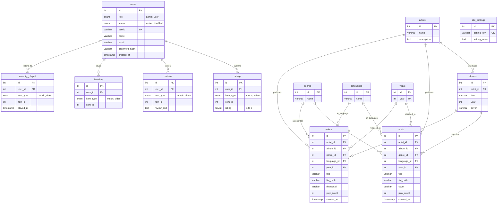

# SOUND — Complete Project & Viva Guide

This document is designed for students defending or explaining the **SOUND** project in a viva, practical examination, or technical interview. It explains the entire architecture, code flow, database design, security principles, and common examiner questions in simple, clear English.

---

## 1. What the Project Does & The Two User Roles

### What is SOUND?
**SOUND** is a full-stack web application for streaming music and videos, browsing catalogs by Artist, Album, Genre, Language, and Release Year, leaving star ratings and text reviews, bookmarking favorites, and tracking listening history. It is built using **pure Vanilla PHP, MySQL (via PDO & MySQLi), HTML5, CSS3, and JavaScript**, without external frameworks or CDN dependencies.

### The Two User Roles

| Role | Permissions & Access | Primary Entry Point |
| :--- | :--- | :--- |
| **Guest / Normal User (`user`)** | - Browse and search all music and video tracks without logging in.<br>- Stream audio via a persistent bottom music player while navigating the site.<br>- Watch video content in an HTML5 video player.<br>- Filter music by Genre, Language, Artist, Album, and Year.<br>- **When logged in**: Submit 1–5 star ratings, write/edit reviews, save items to "Liked", view "Recently Played" history, and manage their profile. | `/sound/index.php`<br>`/sound/login.php`<br>`/sound/register.php` |
| **Administrator (`admin`)** | - Full CRUD (Create, Read, Update, Delete) management of Music, Videos, Artists, Albums, Genres, Languages, and Release Years.<br>- View and toggle user accounts (`active` vs. `disabled`) and reset passwords.<br>- Upload audio (`.mp3`), video (`.mp4`), and cover images (`.jpg`, `.png`, `.webp`).<br>- Configure global site settings (`site_name`, `site_tagline`, `about_text`, contact details). | `/sound/admin/dashboard.php`<br>`/sound/admin/` |

---

## 2. Folder Structure (One Line Per File / Folder)

```text
sound/                                        -> Root project directory located in xampp/htdocs/sound
├── .gitattributes                            -> Git configuration for file line endings and attributes
├── browse.php                                -> Public catalog page grouping items by Artist, Album, Genre, Language, and Year
├── CLAUDE.md                                 -> Project reference notes, commands, and conventions
├── favicon.ico                               -> Binary 32x32 pixel website icon for browser address bar/tabs
├── favicon.svg                               -> Scalable vector website icon featuring coral equalizer bars
├── hash.php                                  -> Utility script for generating Bcrypt password hashes
├── index.php                                 -> Public homepage featuring welcome hero, featured tracks, and quick tiles
├── login.php                                 -> User and administrator login form with authentication handling
├── logout.php                                -> Session destruction script redirecting users to the home page
├── music.php                                 -> Public music library listing and single track detail view
├── register.php                              -> New user registration form with validation and password hashing
├── search.php                                -> Search page with text query and faceted filters (Genre, Language, Year)
├── videos.php                                -> Public video library listing and HTML5 video playback detail view
├── admin/                                    -> Administrator control panel directory
│   ├── add_album.php                         -> Form to create a new album under an existing artist
│   ├── add_artist.php                        -> Form to create a new musical artist profile
│   ├── add_genre.php                         -> Form to add a new musical genre tag
│   ├── add_language.php                      -> Form to register a new song language
│   ├── add_music.php                         -> Form to upload MP3 audio, cover image, and metadata
│   ├── add_video.php                         -> Form to upload MP4 video, thumbnail, and metadata
│   ├── add_year.php                          -> Form to create a release year tag
│   ├── albums.php                            -> Table listing of all albums with edit/delete actions
│   ├── artists.php                           -> Table listing of all artists with track counts and actions
│   ├── dashboard.php                         -> Main admin stats overview (totals of music, videos, users, artists)
│   ├── edit_album.php                        -> Form to modify existing album title, artist, or cover
│   ├── edit_artist.php                       -> Form to update an artist's name and biographical description
│   ├── edit_genre.php                        -> Form to rename an existing genre
│   ├── edit_language.php                     -> Form to rename an existing language
│   ├── edit_music.php                        -> Form to update track details, re-upload MP3, or change cover
│   ├── edit_user.php                         -> Form to change a user's role, toggle status, or reset password
│   ├── edit_video.php                        -> Form to update video metadata, re-upload MP4, or replace thumbnail
│   ├── edit_year.php                         -> Form to update an existing release year
│   ├── genres.php                            -> Table listing of all genres with edit/delete options
│   ├── index.php                             -> Admin index script that safely forwards directly to dashboard.php
│   ├── languages.php                         -> Table listing of all languages with edit/delete options
│   ├── music.php                             -> Master administrative table of all uploaded music tracks
│   ├── settings.php                          -> Form to edit site-wide settings (name, tagline, about text)
│   ├── users.php                             -> Master administrative table of registered users with status controls
│   ├── videos.php                            -> Master administrative table of all uploaded video files
│   ├── years.php                             -> Table listing of all release years with edit/delete options
│   └── includes/                             -> Shared template partials for the admin panel
│       ├── admin_footer.php                  -> Closing HTML tags, admin scripts, and footer copyright
│       └── admin_header.php                  -> Admin navigation sidebar, breadcrumb generator, and session check
├── assets/                                   -> Static frontend assets
│   ├── css/                                  -> Cascading Style Sheets directory
│   │   ├── admin.css                         -> Custom styles for the administrative dashboard and tables
│   │   └── style.css                         -> Master Spotify-inspired dark theme and responsive layout CSS
│   └── js/                                   -> Client-side JavaScript directory
│       └── app.js                            -> Persistent audio player logic and SPA link interception
├── config/                                   -> Global configuration and database bootstrappers
│   ├── config.php                            -> Database credentials, site constants, and environment definitions
│   └── database.php                          -> PDO connection instance and helper functions (query, fetchAll, fetchOne)
├── database/                                 -> SQL database setup files
│   ├── schema.sql                            -> DDL statements creating all 13 database tables and foreign keys
│   ├── seed.sql                              -> Default starter data for admin account, genres, languages, and settings
│   └── sound_backup.sql                      -> Complete snapshot of table schemas and sample records
├── docs/                                     -> Project documentation
│   ├── PROJECT_GUIDE.md                      -> Comprehensive student viva guide and technical explanation
│   └── README.md                             -> General overview, requirements summary, and setup instructions
├── includes/                                 -> Reusable public PHP components and helper logic
│   ├── auth.php                              -> Session checking, role verification, login logic, and CSRF utilities
│   ├── footer.php                            -> Bottom player bar, volume controls, seek bar, and script imports
│   ├── functions.php                         -> Helper functions for reviews, ratings, favorites, history, and cache
│   └── header.php                            -> Public left sidebar, top search bar, user menu, and HTML head
└── uploads/                                  -> Target directory for uploaded binary media
    ├── covers/                               -> Image files for album and music artwork
    ├── music/                                -> Uploaded MP3 audio files
    ├── thumbnails/                           -> Video preview image files
    └── videos/                               -> Uploaded MP4 video files
```

---

## 3. How a Request Flows (Login → Session → Page → Database → HTML)

Every interaction on the site follows a clean, synchronous Model-View-Controller style request lifecycle:

```
[Browser] 
   │ 
   │ 1. HTTP POST /sound/login.php (userid, password, csrf_token)
   ▼
[login.php] 
   │ 
   │ 2. require_once 'includes/auth.php'
   │ 3. validateCSRFToken($_POST['csrf_token'])
   │ 4. login($userid, $password)
   ▼
[Database (MySQL via PDO)] 
   │ 
   │ 5. SELECT * FROM users WHERE userid = ? AND status = 'active'
   │ 6. Returns user row with password_hash
   ▼
[auth.php: login()] 
   │ 
   │ 7. password_verify($input_password, $db_hash) == true
   │ 8. session_regenerate_id(true) [Protects against session fixation]
   │ 9. Populates $_SESSION['user_id'], $_SESSION['user_role'], $_SESSION['user_name']
   ▼
[login.php redirect] 
   │ 
   │ 10. If role == 'admin' -> Header("Location: /sound/admin/dashboard.php")
   │     If role == 'user'  -> Header("Location: /sound/index.php")
   ▼
[Browser (Next Request: GET /sound/admin/dashboard.php)] 
   │ 
   │ 11. Browser automatically sends Cookie: PHPSESSID=...
   ▼
[admin/dashboard.php] 
   │ 
   │ 12. include 'admin/includes/admin_header.php' -> calls requireAdmin()
   │ 13. requireAdmin() checks if $_SESSION['user_role'] === 'admin'
   │ 14. Runs SQL count queries: fetchOne("SELECT COUNT(*) AS total FROM music")
   │ 15. Injects escaped variables into HTML via htmlspecialchars()
   ▼
[Browser receives HTML5] (Rendered with styles from style.css & admin.css)
```

---

## 4. Database Tables & Relationships

The database `sound` contains **13 normalized relational tables**:



### Table Details:
1. **`users`**: Stores user authentication data (`userid`, `password_hash`), permissions (`role`), and status (`active`/`disabled`).
2. **`artists`**: Names and descriptions of music bands or vocalists.
3. **`albums`**: Record collections tied to an artist via `artist_id` (foreign key with `ON DELETE CASCADE`).
4. **`genres`**: Musical categories (e.g., Pop, Rock, Classical, Jazz, Hip Hop).
5. **`languages`**: Supported languages (e.g., English, Hindi, Spanish, Punjabi).
6. **`years`**: Release year integers.
7. **`music`**: Audio track metadata, linking to `artist_id`, `album_id`, `genre_id`, `language_id`, `year_id`, and physical `.mp3` path.
8. **`videos`**: Video clip metadata linking to artist, genre, language, year, and physical `.mp4` path.
9. **`ratings`**: Composite unique key `(user_id, item_type, item_id)` ensuring a user can submit only one rating per track (1 to 5).
10. **`reviews`**: Text feedback submitted by users for music or video items.
11. **`favorites`**: Tracks bookmarked by registered users for quick playback in "Liked".
12. **`recently_played`**: Chronological log of tracks played by a user.
13. **`site_settings`**: Key-value pairs for global configurations (`site_name`, `site_tagline`, `about_text`).

---

## 5. Implementation of Project Requirements

| Requirement | Implementation File | Key Functions / Code Location |
| :--- | :--- | :--- |
| **Guest Access (No Login Required)** | `index.php`, `music.php`, `videos.php`, `browse.php`, `search.php` | Pages do not call `requireLogin()`. SQL queries execute unconditionally. |
| **Authentication & Role Authorization** | `includes/auth.php` | `login()`, `logout()`, `isLoggedIn()`, `isAdmin()`, `requireLogin()`, `requireAdmin()`. |
| **Role-Based Redirects** | `login.php` | Lines 5–10 & 32–37: Check `isAdmin()` → Redirects to `admin/dashboard.php`, else to `index.php`. |
| **Persistent Audio Player** | `includes/footer.php`<br>`assets/js/app.js` | `new Audio()`, `loadTrack()`, `playPauseBtn.addEventListener()`, `audio.addEventListener('timeupdate')`. |
| **SPA Seamless Link Interception** | `assets/js/app.js` | Lines 220–390: `document.addEventListener('click')` checks internal links, fetches content via `fetch()`, replaces `<main class="content">`, and uses `history.pushState()`. |
| **Catalog Browsing by Taxonomies** | `browse.php` | Queries `artists`, `albums`, `genres`, `languages`, and `years` and renders cards/chips. |
| **Faceted Search** | `search.php` | Dynamically builds parameterized SQL query with `WHERE title LIKE ?` and optional filters. |
| **Ratings System** | `includes/functions.php`<br>`music.php` | `addRating($userId, $itemType, $itemId, $rating)` with `ON DUPLICATE KEY UPDATE`. |
| **Reviews System** | `includes/functions.php`<br>`music.php` | `addReview()`, `getReviews()`. Displays formatted reviews and author avatars. |
| **Favorites / Liked List** | `includes/functions.php`<br>`favorites.php` | `addToFavorites()`, `removeFromFavorites()`, `isInFavorites()`. |
| **Recently Played** | `includes/functions.php` | `addToRecentlyPlayed()`, `getRecentlyPlayed()`. |
| **Admin CRUD Modules** | `admin/*.php` (26 files) | Full Add, Edit, Delete for Music, Videos, Artists, Albums, Genres, Languages, Years, Users, and Settings. |
| **Admin Shared Navigation** | `admin/includes/admin_header.php`<br>`admin_footer.php` | Sidebar with active link highlighting, breadcrumb generation, flash messages, and logout. |
| **Site Settings Editor** | `admin/settings.php` | Updates `site_settings` table via prepared statements for key/value pairs. |

---

## 6. How Key Features Work Internally

### 1. File Uploading
- **Location**: `admin/add_music.php`, `admin/add_video.php`, `admin/edit_music.php`, `admin/edit_video.php`.
- **How it works**:
  1. The HTML form uses `enctype="multipart/form-data"` and HTTP `POST`.
  2. PHP verifies `$_FILES['music_file']['error'] === UPLOAD_ERR_OK`.
  3. The extension is extracted using `pathinfo($_FILES['...']['name'], PATHINFO_EXTENSION)` and cast to lowercase.
  4. An array whitelist verifies extensions (`mp3` for audio; `mp4` for video; `jpg, jpeg, png, gif, webp` for covers).
  5. The file size is verified against defined limits (100MB for media; 10MB for images).
  6. A secure unique filename is created using `uniqid('track_') . '.' . $file_ext` to eliminate name collisions and prevent path traversal attacks.
  7. `move_uploaded_file()` relocates the file from the PHP temp directory to `uploads/music/` or `uploads/covers/`.

### 2. Rating System
- **Location**: `includes/functions.php` (`addRating()`, `getAverageRating()`).
- **How it works**:
  - Uses an `INSERT ... ON DUPLICATE KEY UPDATE` query on the `ratings` table with a composite unique index on `(user_id, item_type, item_id)`.
  - If a user votes 4 stars today and later votes 5 stars, the database updates their existing vote rather than creating a duplicate row.
  - Average stars are calculated using SQL: `SELECT AVG(rating) AS average_rating, COUNT(*) AS rating_count FROM ratings WHERE item_type = ? AND item_id = ?`.

### 3. Review System
- **Location**: `includes/functions.php` (`addReview()`, `getReviews()`).
- **How it works**:
  - Accepts user text via a form, trims whitespace, validates length, and inserts it with `user_id`, `item_type`, and `item_id`.
  - When rendering reviews, an `INNER JOIN users ON reviews.user_id = users.id` retrieves the reviewer's display name and date.

### 4. Search & Multi-Filter Engine
- **Location**: `search.php`.
- **How it works**:
  - Reads `$_GET['q']`, `$_GET['type']`, `$_GET['genre_id']`, `$_GET['language_id']`, `$_GET['year_id']`.
  - Dynamically constructs the SQL `WHERE` clause:
    ```php
    $conditions = ["m.title LIKE ?"];
    $params = ['%' . $search_query . '%'];
    if (!empty($genre_id)) { $conditions[] = "m.genre_id = ?"; $params[] = $genre_id; }
    $sql .= " WHERE " . implode(" AND ", $conditions);
    ```
  - Executes safely with prepared statements.

### 5. The "NEW" Badge
- **Location**: `index.php`, `music.php`, `videos.php`, `assets/css/style.css`.
- **How it works**:
  - In PHP, the item's creation timestamp is compared against a 7-day or 30-day window:
    ```php
    $is_new = (strtotime($item['created_at']) > strtotime('-30 days'));
    ```
  - If true, it outputs `<span class="badge-new">NEW</span>` positioned over the card thumbnail.
  - In `style.css`, `.badge-new` applies the solid coral background (`#FF5A3C`) and a CSS keyframe animation (`@keyframes badge-pulse`) that smoothly pulses its opacity.

### 6. The Audio Player & SPA Engine
- **Location**: `includes/footer.php` & `assets/js/app.js`.
- **How it works**:
  - An HTML5 audio element (`new Audio()`) runs inside JavaScript.
  - Clicking any play button reads track metadata from `data-id`, `data-title`, `data-artist`, `data-url`, and `data-cover` attributes, updating the bottom player DOM elements.
  - An event listener on `audio.addEventListener('timeupdate')` calculates the percentage `(currentTime / duration) * 100` and adjusts the width of `.progress`.
  - Internal anchor clicks (`<a href="/sound/...">`) are intercepted with `event.preventDefault()`. JavaScript fetches the target URL in the background, extracts only `<main class="content">`, and swaps it in place. The audio continues playing seamlessly without interruption.

---

## 7. Security Measures Implemented

| Security Threat | Defense Mechanism Used | Exact Code Location |
| :--- | :--- | :--- |
| **Password Theft / Plaintext Passwords** | Secure one-way hashing with **Bcrypt** (`PASSWORD_DEFAULT`), utilizing automated salt generation. | `register.php`: `password_hash($password, PASSWORD_DEFAULT)`<br>`includes/auth.php`: `password_verify($password, $user['password_hash'])`<br>`admin/edit_user.php`: `password_hash()` |
| **SQL Injection (SQLi)** | **Prepared statements with parameter binding** across all database interactions (PDO and MySQLi). Never concatenating raw user variables into SQL strings. | `config/database.php`: `$stmt = $pdo->prepare($sql); $stmt->execute($params);`<br>`includes/functions.php`: `$stmt->bind_param(...)`<br>All files in `admin/*.php` |
| **Cross-Site Request Forgery (CSRF)** | **Cryptographic tokens** generated per session using `random_bytes(32)`. Every state-changing form includes a hidden token validated via timing-attack safe `hash_equals()`. | `includes/auth.php`: `generateCSRFToken()` and `validateCSRFToken()`<br>`login.php`, `register.php`, and all `admin/add_*.php` / `admin/edit_*.php` forms |
| **Cross-Site Scripting (XSS)** | **Contextual HTML entity encoding** using `htmlspecialchars()` on every variable printed into the HTML DOM. | `includes/header.php`, `admin/includes/admin_header.php`, and every PHP view template (`htmlspecialchars($val, ENT_QUOTES, 'UTF-8')`) |
| **Session Fixation** | Generating a fresh session identifier immediately upon successful authentication. | `includes/auth.php`: `session_regenerate_id(true)` called inside `login()` |
| **Malicious File Upload / Remote Code Execution (RCE)** | Strict extension whitelisting, MIME verification, file size checking, and random filename renaming with `uniqid()`. | `admin/add_music.php` (lines 53–105)<br>`admin/add_video.php` (lines 52–104) |
| **Unauthorized Administrative Access** | Role validation checks at the very top of protected scripts before any page rendering or action. | `includes/auth.php`: `requireAdmin()`<br>`admin/includes/admin_header.php`: calls `requireAdmin()` on line 6 |

---

## 8. Important URLs & How to Open Them

Make sure XAMPP Apache and MySQL are running. Open any standard web browser (Chrome, Edge, Firefox) and access the URLs below:

### Public Pages
- **Homepage**: [http://localhost/sound/](http://localhost/sound/) or [http://localhost/sound/index.php](http://localhost/sound/index.php)
- **Music Library**: [http://localhost/sound/music.php](http://localhost/sound/music.php)
- **Video Library**: [http://localhost/sound/videos.php](http://localhost/sound/videos.php)
- **Browse Categories**: [http://localhost/sound/browse.php](http://localhost/sound/browse.php)
- **Search Engine**: [http://localhost/sound/search.php](http://localhost/sound/search.php)
- **User Login**: [http://localhost/sound/login.php](http://localhost/sound/login.php)
- **New User Registration**: [http://localhost/sound/register.php](http://localhost/sound/register.php)
- **User Profile** (Requires Login): [http://localhost/sound/profile.php](http://localhost/sound/profile.php)
- **Liked / Favorites** (Requires Login): [http://localhost/sound/favorites.php](http://localhost/sound/favorites.php)
- **About Page**: [http://localhost/sound/about.php](http://localhost/sound/about.php)
- **Logout Action**: [http://localhost/sound/logout.php](http://localhost/sound/logout.php)

### Admin Management Pages (Requires Admin Role)
- **Admin Dashboard**: [http://localhost/sound/admin/dashboard.php](http://localhost/sound/admin/dashboard.php) (or `/sound/admin/`)
- **Manage Music**: [http://localhost/sound/admin/music.php](http://localhost/sound/admin/music.php)
- **Upload Music Track**: [http://localhost/sound/admin/add_music.php](http://localhost/sound/admin/add_music.php)
- **Manage Videos**: [http://localhost/sound/admin/videos.php](http://localhost/sound/admin/videos.php)
- **Upload Video**: [http://localhost/sound/admin/add_video.php](http://localhost/sound/admin/add_video.php)
- **Manage Artists**: [http://localhost/sound/admin/artists.php](http://localhost/sound/admin/artists.php)
- **Add Artist**: [http://localhost/sound/admin/add_artist.php](http://localhost/sound/admin/add_artist.php)
- **Manage Albums**: [http://localhost/sound/admin/albums.php](http://localhost/sound/admin/albums.php)
- **Add Album**: [http://localhost/sound/admin/add_album.php](http://localhost/sound/admin/add_album.php)
- **Manage Genres**: [http://localhost/sound/admin/genres.php](http://localhost/sound/admin/genres.php)
- **Add Genre**: [http://localhost/sound/admin/add_genre.php](http://localhost/sound/admin/add_genre.php)
- **Manage Languages**: [http://localhost/sound/admin/languages.php](http://localhost/sound/admin/languages.php)
- **Add Language**: [http://localhost/sound/admin/add_language.php](http://localhost/sound/admin/add_language.php)
- **Manage Years**: [http://localhost/sound/admin/years.php](http://localhost/sound/admin/years.php)
- **Add Year**: [http://localhost/sound/admin/add_year.php](http://localhost/sound/admin/add_year.php)
- **Manage Users**: [http://localhost/sound/admin/users.php](http://localhost/sound/admin/users.php)
- **Site Settings**: [http://localhost/sound/admin/settings.php](http://localhost/sound/admin/settings.php)

---

## 9. Setup Steps on a New PC with XAMPP

If you are presenting this project on a different machine or examiner laptop, follow these exact steps:

1. **Install XAMPP**:
   - Download XAMPP for Windows (PHP 8.x) from [apachefriends.org](https://www.apachefriends.org).
   - Install it to `C:\xampp` or `D:\xampp`.

2. **Copy Project Folder**:
   - Copy the entire project folder `sound` into the `htdocs` directory:
     `C:\xampp\htdocs\sound` or `D:\xampp\htdocs\sound`.

3. **Start Servers**:
   - Open the **XAMPP Control Panel**.
   - Click **Start** for **Apache**.
   - Click **Start** for **MySQL**.

4. **Import Database**:
   - Open your browser and go to [http://localhost/phpmyadmin/](http://localhost/phpmyadmin/).
   - Click **New** in the left sidebar, enter database name: `sound`, and select Collation `utf8mb4_unicode_ci`. Click **Create**.
   - With the `sound` database selected, click the **Import** tab.
   - Choose file: browse to `sound/database/schema.sql` (or `sound_backup.sql`) and click **Import**.
   - If importing `schema.sql`, also import `seed.sql` to populate default categories, settings, and the admin user.

5. **Verify Database Configuration**:
   - Open `sound/config/config.php` in a text editor.
   - Ensure the database credentials match your local setup:
     ```php
     define('DB_HOST', 'localhost');
     define('DB_USER', 'root');
     define('DB_PASS', '');       // Blank password by default in XAMPP
     define('DB_NAME', 'sound');
     ```

6. **Verify Upload Directories**:
   - Ensure `uploads/music/`, `uploads/videos/`, and `uploads/covers/` exist and have write permissions.

7. **Open and Test**:
   - Visit [http://localhost/sound/](http://localhost/sound/).
   - Log in with default credentials:
     - **Admin**: User ID: `admin`, Password: `adminpassword` (or as seeded in `seed.sql`).

---

## 10. 25 Likely Viva Questions & Short Answers

### Q1: What is the main purpose of this project?
**Answer**: SOUND is a full-stack media streaming web application that allows users to stream music and videos, discover content by taxonomies (Artist, Album, Genre, Language, Year), leave reviews and star ratings, while providing administrators with a backend panel to manage media and site settings.

### Q2: Why did you use plain PHP instead of a framework like Laravel?
**Answer**: Plain PHP demonstrates a strong foundational understanding of web development core principles, including HTTP request lifecycles, direct PDO database queries, manual session state management, raw file streaming, and writing custom security controls from scratch without relying on framework abstractions.

### Q3: What is PDO and why is it preferred over `mysqli`?
**Answer**: PDO (PHP Data Objects) is an abstraction layer that provides a uniform interface for accessing databases. It supports named parameters, prepared statements, and error handling via exceptions. While `mysqli` only works with MySQL, PDO works with multiple database engines.

### Q4: How do prepared statements protect against SQL Injection?
**Answer**: Prepared statements separate the SQL query logic from the incoming user data. The database compiles the SQL template first; user inputs are then bound purely as literal values, never as executable SQL commands, making SQL injection impossible.

### Q5: How is user authentication managed across pages?
**Answer**: Through PHP sessions (`session_start()`). Upon successful password verification, user identifiers (`user_id`, `user_role`, `user_name`) are stored on the server inside `$_SESSION`. The browser only stores a small session cookie (`PHPSESSID`) which is validated on each incoming request.

### Q6: What is session fixation and how did you prevent it?
**Answer**: Session fixation is an attack where an adversary tricks a victim into using a known session ID, allowing the attacker to hijack the session after login. We prevent this by calling `session_regenerate_id(true)` immediately when the user logs in, which deletes the old session ID and generates a completely new one.

### Q7: What algorithm is used to hash passwords and why not MD5 or SHA-256?
**Answer**: We use PHP's `password_hash()` with `PASSWORD_DEFAULT` (Bcrypt). MD5 and plain SHA-256 are fast general-purpose cryptographic hashes vulnerable to brute-force and rainbow table attacks. Bcrypt is deliberately computationally intensive, incorporates a random salt automatically, and has an adjustable work factor.

### Q8: What is CSRF and how does your application prevent it?
**Answer**: Cross-Site Request Forgery (CSRF) tricks an authenticated user's browser into executing unauthorized actions on a trusted site. We generate a cryptographically random token (`bin2hex(random_bytes(32))`) stored in `$_SESSION['csrf_token']` and embed it in every POST form. On submission, `hash_equals()` checks if the submitted token matches the session token.

### Q9: Why use `hash_equals()` instead of `==` for CSRF token comparison?
**Answer**: `hash_equals()` performs a timing-attack safe string comparison. Regular `==` returns `false` as soon as the first character mismatches, allowing attackers to measure microscopic response time differences to guess the token byte-by-byte.

### Q10: How does the music keep playing when navigating between pages?
**Answer**: In `assets/js/app.js`, we intercept internal link click events (`e.preventDefault()`). We fetch the destination page asynchronously via AJAX (`fetch()`), parse the HTML response, extract `<main class="content">`, and replace only that container, updating the browser URL with `history.pushState()`. Because the page never reloads, the `<audio>` element keeps playing continuously.

### Q11: How do you prevent users from uploading malicious PHP scripts?
**Answer**: In `admin/add_music.php`, we enforce an extension whitelist (`mp3` for audio, `jpg/png/webp` for covers), verify file sizes, and rename every uploaded file using `uniqid()` so an uploaded file like `shell.php` cannot execute.

### Q12: How is the database schema normalized?
**Answer**: The database adheres to 3rd Normal Form (3NF). Repeating attributes like genres, languages, artists, and years are abstracted into distinct lookup tables, referenced via foreign keys (`artist_id`, `genre_id`, etc.) with referential integrity rules (`ON DELETE CASCADE` or `SET NULL`).

### Q13: How does the star rating widget ensure a user only votes once?
**Answer**: The `ratings` table has a composite unique constraint: `UNIQUE KEY (user_id, item_type, item_id)`. The SQL statement uses `INSERT INTO ratings (...) VALUES (...) ON DUPLICATE KEY UPDATE rating = VALUES(rating)`, updating the vote if it already exists instead of duplicating it.

### Q14: What is the purpose of `htmlspecialchars()` and what happens if omitted?
**Answer**: It converts special characters (like `<`, `>`, `&`, `"`) into their corresponding HTML entities (`&lt;`, `&gt;`). If omitted, user-submitted content could include `<script>` tags, causing Cross-Site Scripting (XSS) where an attacker could steal cookies or hijack user sessions.

### Q15: How does role-based access control work for the Admin panel?
**Answer**: Every administrative file includes `admin/includes/admin_header.php`, which executes `requireAdmin()`. This function verifies that `$_SESSION['user_id']` is set and `$_SESSION['user_role'] === 'admin'`. If not, it redirects the client to the login page or home page and halts execution with `exit`.

### Q16: Why is `exit;` placed immediately after `header('Location: ...')`?
**Answer**: `header('Location: ...')` merely adds an HTTP redirect header to the response packet; it does not stop PHP script execution. Without an explicit `exit;` or `die;`, PHP continues executing code below the redirect, which could allow unauthorized database updates or data leaks.

### Q17: What is the difference between `GET` and `POST` methods in this project?
**Answer**: `GET` is used for idempotent operations like searching, filtering, and page navigation where parameters are passed in the URL and can be bookmarked. `POST` is used for state-changing operations like login, user registration, media uploading, and deletion, keeping parameters out of the URL and browser history.

### Q18: What is the purpose of `config/config.php`?
**Answer**: It acts as the central source of configuration, defining global constants such as database connection parameters (`DB_HOST`, `DB_NAME`, `DB_USER`, `DB_PASS`), site name, and base path constants, ensuring settings can be changed in one place.

### Q19: How are the "Recently Played" tracks stored and fetched?
**Answer**: When a user plays a track, a record is added to the `recently_played` table with `user_id`, `item_type`, `item_id`, and `played_at = CURRENT_TIMESTAMP`. On the homepage or profile, a `LEFT JOIN` on `music` and `videos` ordered by `played_at DESC LIMIT 10` retrieves their recent history.

### Q20: What is the difference between `INNER JOIN` and `LEFT JOIN` as used here?
**Answer**: An `INNER JOIN` returns rows only when there is a match in both tables (e.g., music must have a matching artist). A `LEFT JOIN` returns all rows from the left table even if the right table has no match (e.g., retrieving music where `album_id` is `NULL` for standalone singles).

### Q21: What is CSS glassmorphism/variables and why use custom CSS properties (`:root`)?
**Answer**: CSS variables (`var(--accent)`, `var(--bg-base)`) define design tokens globally at `:root`. If the design color or spacing needs modification, changing a single line in `style.css` instantly updates buttons, seek bars, active navigation links, and badges throughout the entire application.

### Q22: What happens if MySQL is down when a user visits the site?
**Answer**: In `config/database.php`, the PDO connection is wrapped in a `try-catch` block catching `PDOException`. If the connection fails, it terminates cleanly with `die("Could not connect to the database: ...")`, preventing PHP stack traces from revealing sensitive server credentials to visitors.

### Q23: How does the search engine handle multi-criteria filtering?
**Answer**: It reads inputs from `$_GET` and dynamically builds a SQL query with placeholder `?` marks. Array variables are appended for each active filter (e.g., `$params[] = $genre_id`), and `$stmt->execute($params)` runs the query, ensuring flexibility without risking SQL injection.

### Q24: How does the "NEW" badge decide whether to display?
**Answer**: It calculates the difference between current time and the track's `created_at` timestamp: `strtotime($track['created_at']) > strtotime('-30 days')`. If the song was uploaded within the last 30 days, a glowing coral `<span class="badge-new">NEW</span>` is rendered on the card.

### Q25: If this application were deployed to production on Linux, what changes would be needed?
**Answer**:
1. Update database credentials in `config/config.php`.
2. Configure Apache VirtualHost or Nginx reverse proxy with HTTPS (SSL/TLS).
3. Set file permissions (`chmod 755` for directories, `chmod 775` for `uploads/`).
4. Disable PHP display errors in `php.ini` (`display_errors = Off`, `log_errors = On`).
5. Ensure `upload_max_filesize` and `post_max_size` in `php.ini` are set to at least 100MB to allow media uploads.
